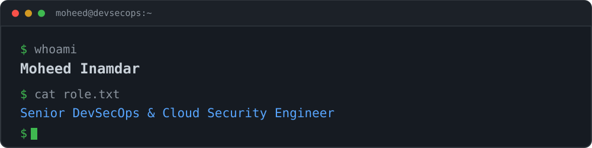
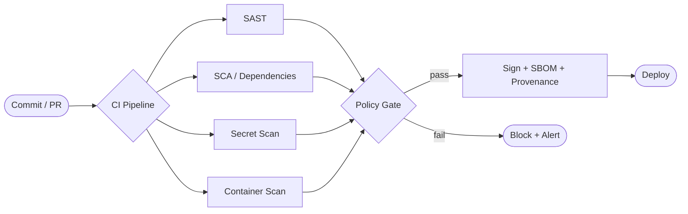

<div align="center">

# Hey, I'm Moheed! 

### Senior Platform & DevOps Engineer · 7+ Years · Developer Platforms, Delivery & Platform Security

[](https://linkedin.com/in/moheedinamdar)
[](https://github.com/moheedinamdar)
[](https://moheedinamdar.github.io/)
[](mailto:moheedinamdar@gmail.com)


</div>


## About Me

```yaml
apiVersion: platform.engineering/v1
kind: SeniorEngineer
metadata:
  name: Moheed Inamdar
  namespace: pune-maharashtra
  labels:
    role: Senior Platform & DevOps Engineer
    company: Globant (Client: Roche - GxP regulated)
    experience: "7+ years"
    started: "January 2019"
spec:
  summary: |
    Platform and DevOps engineer building internal developer platforms,
    golden-path CI/CD and secure-by-default delivery across a
    GxP-regulated estate of 300+ GitHub orgs, 180K+ repositories and
    5K+ GitLab groups in pharma, healthcare and cybersecurity. Moved
    the enterprise from opt-in to enforced-by-default scanning on every
    eligible project, cut CI/CD onboarding by ~60%, and built the
    governance and measurement layer underneath it.
  currentFocus:
    - Internal Developer Platforms (Backstage scaffolder, golden-path templates)
    - Repository-centric security and governance automation at scale
    - Verification: per-run least-privilege credentials, fail-closed
      preflight, dry-run, audit on every outcome
    - Vulnerability operations: scanner normalisation, MTTR, backlog age
  learningInPublic:
    - Workload identity and OIDC federation (no production experience yet)
    - Policy engines: OPA/Rego and Kyverno (no production experience yet)
    - OpenTelemetry (no production experience yet)
  openTo:
    roles:
      - Senior Platform Engineer
      - Security Platform Engineer
      - DevEx Platform Engineer
      - Senior DevOps Engineer
    locations: [Pune, Hyderabad, UAE, Singapore, Remote]
  certifications: none currently held
  education:
    - B.E. in Computer Engineering, Pune University (2015-2018)
```


## Secure SDLC at Enterprise Scale




## Career Journey (Jan 2019 - Present)

```
2019           2020              2024              2026 →
 │              │                 │                 │
 ├──────────────┼─────────────────┼─────────────────┤
 │ CenturySoft  │ Zymr (Virsec)   │ Globant (Roche) │ Senior Platform /
 │ Associate    │ Senior DevOps   │ Sr. DevSecOps   │ Security Platform
 │ Developer    │ Engineer (Lead) │ Engineer (SME)  │ Engineer
 ├──────────────┼─────────────────┼─────────────────┤
   AWS · Jenkins  Docker · K8s ·    Platform · IDPs     Developer platforms,
   Python · ETL   Terraform ·       Backstage · GHAS    governance
   Cloud Migrate  Container Sec     180K+ repo estate,  automation,
                  shift-left sec    300+ orgs,          verification
                  pipelines         enforced scanning
```


## Featured Projects

> Things I maintain, and things I am learning in public. The status column is honest:
> "working" means you can run it today, "scaffold" means the interfaces exist and the
> hard parts are still TODO.

| Project | Description | Status |
|---------|-------------|--------|
| **[precommit-security-hooks](https://github.com/moheedinamdar/precommit-security-hooks)** | Pre-commit bundle that blocks secrets, unsafe Dockerfiles and insecure IaC before they reach a repo. Every scanner runs from its official, version-pinned container image. Three layered profiles | Working |
| **[setup-personal-work-git-profiles](https://github.com/moheedinamdar/setup-personal-work-git-profiles)** | Cross-platform wizard for multiple Git identities on one machine, auto-routed by directory, with per-profile SSH keys and commit signing | Working |
| **[naukri-auto-update](https://github.com/moheedinamdar/naukri-auto-update)** | Headful Playwright automation with a persistent browser profile, built around real bot-protection constraints | Working |
| **[nuke-docker](https://github.com/moheedinamdar/nuke-docker)** | One script to reset Docker to a freshly-installed state, with a full preview before it deletes anything | Working |
| **[Supply Chain Security Pipeline](https://github.com/moheedinamdar/supply-chain-security-pipeline)** | Learning in public. CI wires up Syft SBOM generation, Grype scanning and cosign signing; SLSA provenance and Kyverno admission verification are not finished | Scaffold |
| **[AI Vulnerability Triage](https://github.com/moheedinamdar/ai-vulnerability-triage)** | Learning in public. SARIF ingest and de-duplication work; EPSS/KEV enrichment and the LLM prioritiser are not implemented yet | Scaffold |


## Tech Stack & Expertise

<div align="center">

### Cloud & Infrastructure


### Containers & Orchestration


### CI/CD & GitOps


### Security Scanning (SAST · SCA · Secrets · Container)


### Platform Engineering


### Learning in public (no production experience yet)


### Secrets & Identity


### Observability


### Languages & Scripting


</div>


## Key Achievements

<table>
<tr>
<td width="50%">

**At Globant, Client: Roche (2024-Present)**

- Designed and built the **repository governance control plane** (Backstage scaffolder over a Python control plane) and the **GitHub security engine** (Python/FastAPI/GitHub Apps)
- Worked across an estate of **300+ orgs · 180K+ repos · 5K+ groups**
- Drove security scanning from opt-in to enforced-by-default on every eligible project
- Designed reusable secure CI/CD templates cutting onboarding by **~60%**
- Built a security analytics platform normalising every scanner into one severity model (pre-production)
- Led team of 3 engineers · 15+ enablement sessions

</td>
<td width="50%">

**At Zymr, Client: Virsec (2020-2024)**

- Shifted security left, catching the majority of vulnerabilities pre-staging
- Hardened **50+ Docker images** against CIS Benchmarks
- Reduced infra provisioning time by **70%** with serverless architecture
- Designed DR & high availability (multi-AZ) on AWS Well-Architected
- Led microservices migration, mentoring 10+ developers
- Core member of Virsec product security research team

</td>
</tr>
</table>


## Awards & Recognition

| Award | Year | Details |
|-------|------|---------|
| **Pat on the Back Award**: Globant | 2024 | Recognised for leading the internal developer and security metrics platform, and for cross-functional work in security automation |
| **2nd Place, Z-Hackathon**: Zymr | 2023 | AI-powered NLP summarisation system over synthetic and open datasets |


## Contribution Activity

<div align="center">


</div>


## Currently

- Building developer platforms and governance automation at **Globant (Roche / GxP regulated)**
- Maintaining open-source developer tooling, and learning supply-chain security in public
- Writing about platform engineering and secure delivery at scale
- **Open to Senior Platform Engineer · Security Platform Engineer · DevEx Platform Engineer · Senior DevOps** roles in Pune, Hyderabad, UAE, Singapore, or Remote


<div align="center">

### Let's Connect

**Open to collaborating on Platform Engineering, Developer Experience, DevSecOps and secure software delivery projects.**

[](mailto:moheedinamdar@gmail.com)
[](https://linkedin.com/in/moheedinamdar)
[](https://moheedinamdar.github.io/)


</div>
